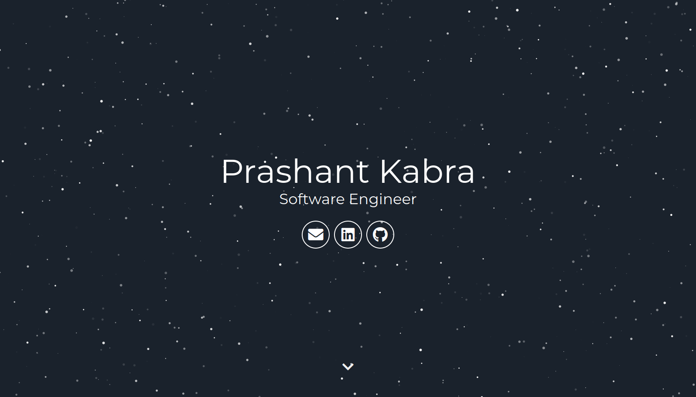

# Minimal Resume -- Jekyll Theme

A clean, single-page resume theme built with Jekyll. Designed for developers who want a professional minimal resume without the bloat.

[Live Demo](https://jekyll-theme-minimal-resume.netlify.app) -- [Report a Bug](https://github.com/murraco/jekyll-theme-minimal-resume/issues)

[](https://app.netlify.com/sites/jekyll-theme-minimal-resume/deploys)

[](https://jekyll-theme-minimal-resume.netlify.app)

## Features

- Single-page layout with smooth scrolling
- Particle.js animated header
- Data-driven expertise section (no HTML editing needed)
- Responsive design (mobile-first)
- Social/SEO meta tags and JSON-LD structured data
- Sass-based styling with simple color customization
- Docker support for quick preview
- Deploys to GitHub Pages, Netlify, or any static host

## Stack

- **Site generator:** Jekyll 3.10 via the `github-pages` gem, so what builds locally is what GitHub Pages builds. Content comes from `_config.yml` and YAML data files, not hardcoded HTML.
- **Styling:** Sass, one partial per section (`_header`, `_about`, `_stats`, `_footer`), with colors and breakpoints in `src/styles/_vars.scss`.
- **Build:** Gulp compiles Sass and JavaScript from `src/` into `assets/`, then hands off to Jekyll. `npm run serve` watches both and reloads the browser.
- **Front-end:** no framework and no jQuery. particles.js draws the animated hero background, sweet-scroll handles anchor scrolling.
- **Icons:** Font Awesome for social links, Devicon for the technology logos in the expertise grid. Both are self-hosted from `assets/fonts`, so the page makes no third-party requests.
- **Deployment:** plain static output. Netlify, GitHub Pages, or any static host. Docker Compose is included for a preview with no Ruby or Node installed.

## File structure

```
jekyll-theme-minimal-resume/
│
├── _config.yml              # site and user settings (name, title, bio, social handles)
├── index.html               # entry page; layout does the work
│
├── _data/
│   ├── expertise.yml        # "What I Do" panels: titles, copy, Devicon icon names
│   └── stats.yml            # optional stat band (disabled by default in the layout)
│
├── _includes/
│   ├── head.html            # meta tags, Open Graph, JSON-LD structured data
│   ├── header.html          # hero: name, title, social icons
│   ├── about.html           # renders _data/expertise.yml
│   ├── stats.html           # renders _data/stats.yml
│   └── footer.html          # footer and script tags
│
├── _layouts/
│   └── default.html         # assembles the includes
│
├── src/                     # sources; edit these, not assets/
│   ├── styles/              # Sass partials + main.scss
│   ├── js/app.js            # particles.js and sweet-scroll config
│   └── fonts/               # Font Awesome and Devicon webfonts
│
├── assets/                  # Gulp output; committed so GitHub Pages can serve it
├── gulpfile.js              # sass, js, fonts, and jekyll tasks
└── docker-compose.yml       # preview stack (see docker-compose.dev.yml for live edits)
```

> `assets/` is generated. Edit `src/` and run `npm run build`, otherwise your changes are overwritten on the next build.

## Quick start

1. Install Ruby 3.3.6 (pinned in `.ruby-version`), [Bundler](https://bundler.io/), and Node.js 20 or newer.
2. Fork this repository and clone your fork.
3. Copy or edit `_config.yml` to personalize your site (see [Settings](#settings)).

## Development (local)

Styles and scripts are built from `src/` into `assets/` with **Gulp**; Jekyll then copies them into `_site`.

1. **Ruby dependencies:** the repo pins **Ruby 3.3.6** in `.ruby-version` so Bundler can resolve `github-pages`. With rbenv or asdf, `rbenv install` / `asdf install` picks it up automatically, then:

   ```bash
   bundle install
   ```

   `Gemfile.lock` is committed and the Docker image installs from it too, so local builds, container builds, and GitHub Pages all resolve the same gem versions. If `bundle` complains it cannot find the bundler version the lockfile was built with, install it (`gem install bundler:2.5.22`) or run `bundle update --bundler`. Running against your system Ruby instead of the pinned one is the usual cause.

2. **Node dependencies**:

   ```bash
   npm install
   ```

3. **One-off build** (compile Sass/JS, then Jekyll):

   ```bash
   npm run build
   ```

4. **Live reload** (Gulp compiles `src/` into `assets/`; `jekyll serve --livereload` serves the
   site and refreshes the browser):

   ```bash
   npm run serve
   ```

   Or preview without the asset watcher after a build:

   ```bash
   npm run build && bundle exec jekyll serve
   ```

## Docker

Requirements: [Docker](https://docs.docker.com/get-docker/) and [Docker Compose V2](https://docs.docker.com/compose/install/) (`docker compose`).

### Quick preview (site built inside the image)

Use this to try the theme without installing Ruby or Node on your machine.

```bash
docker compose up --build
```

Open [http://localhost:4000](http://localhost:4000). The site is baked into the image, so restart the container to pick up changes, or use the [local workflow with `npm run serve`](#development-local) for live reload.

- **Build only** (output stays in the container, no HTTP server):

  ```bash
  docker compose run --rm site bundle exec jekyll build
  ```

  To write `_site` on the host:

  ```bash
  docker compose run --rm -v "$(pwd)/_site:/out" site \
    sh -c "bundle exec jekyll build --destination /out"
  ```

### Development with the repo bind-mounted

Edits to `_config.yml`, `_includes/`, `src/`, etc. apply after you **restart** the container (the entrypoint runs `bundle install`, `npm ci`, and `npm run build` again). Named volumes cache gems and `node_modules` so the host tree does not need local `node_modules`.

```bash
docker compose -f docker-compose.yml -f docker-compose.dev.yml up --build
```

Stop with `Ctrl+C` or `docker compose down`. Volumes `jekyll_bundle` and `jekyll_node_modules` persist until you remove them (e.g. `docker volume rm`).

### Optional environment variables (development)

| Variable      | Default | Description              |
|---------------|---------|--------------------------|
| `JEKYLL_PORT` | `4000`  | HTTP port for Jekyll     |

Example:

```bash
JEKYLL_PORT=8080 docker compose -f docker-compose.yml -f docker-compose.dev.yml up
```

If you change the port, map it in `docker-compose.yml` as well (e.g. `"8080:8080"`).

### Environment variables

This theme does not require API keys or `.env` files. All customization is done via `_config.yml` and HTML includes.

## Deploy on Wasmer

[](https://wasmer.io/apps/create?github=murraco%2Fjekyll-theme-minimal-resume)

Wasmer detects this repository as a Jekyll site: it runs `bundle install` (from the committed `Gemfile.lock`) and `jekyll build`, then serves `_site`. Gulp is not run there, so commit the compiled files in `assets/` after changing `src/` (`npm run build`). The button opens Wasmer's import page for this demo, where you review the configuration and click Deploy; it does not create a copy of the repository in your GitHub account; to publish your own resume, fork the repository, edit `_config.yml` and `_data/`, and import your fork on Wasmer.

## Settings

Fill in the following in `_config.yml` to customize your site.

### Site settings

```yml
description: A short description for meta tags
baseurl: "" # subpath of your site, e.g. /blog/
url: "https://your-domain.example" # full site URL including protocol (needed for canonical URLs, Open Graph, and JSON-LD)
lang: en # document language (<html lang="...">)
social_image: /assets/favicon.png # Open Graph / Twitter preview image (path from site root)
og_locale: en_US # optional; og:locale meta tag
theme_color: "#1a222c" # optional; mobile browser chrome color
```

### User settings

```yml
username: Your Name
user_description: Short bio shown on the page
user_title: Your headline
email: you@example.com
linkedin_username: yourprofile
github_username: yourprofile
```

> Set `url` and `baseurl` correctly before you deploy (GitHub Pages, Netlify, etc.). Social preview tags (`og:image`, etc.) need a valid `url` so absolute image URLs resolve.

### Expertise section (skills columns)

The three columns under "What I Do" are driven by **`_data/expertise.yml`**: the section heading, plus a title, body copy, optional highlight caption, and Devicon class names per column (see [Devicon](https://devicon.dev/) for available icons bundled in the theme CSS). Edit that file instead of large HTML blocks.

After changing `_data/expertise.yml`, rebuild with Jekyll (or `npm run build` / `npm run serve`).

### Color and particle customization

- **Colors:** edit Sass variables under `src/styles/` (for example `src/styles/_vars.scss`).
- **Particles:** edit the configuration in `src/js/app.js` (see [particles.js](https://github.com/VincentGarreau/particles.js/) for options). After changes, run `npm run build` or `npm run serve` so `assets/js/main.js` is regenerated.

### Content

Edit `_includes/header.html` and `_includes/footer.html` for social links and layout. Use **`_data/expertise.yml`** for the expertise grid (see above). Add more pages via `index.html` or new files in the project root. Example link markup:

```html
<a aria-label="My Github" target="_blank" rel="noopener noreferrer" href="https://github.com/youruser">
  <i class="icon fa fa-github-alt" aria-hidden="true"></i>
</a>
```

## Testing

There are no automated tests in this repository; verify changes with `npm run build` and by opening the generated site under `_site/`.

## Author

**Mauricio Urraco** -- Software Engineer with 10+ years of experience.

- [GitHub](https://github.com/murraco)
- [LinkedIn](https://www.linkedin.com/in/murraco)

## Credits

- [Nathan Randecker](https://github.com/nrandecker)

## Contribution

- Report issues
- Open pull request with improvements
- Spread the word
- Reach out to me directly at <mauriurraco@gmail.com>

## License

Released under the [MIT License](LICENSE).

## Support

If this project helped you, consider buying me a coffee ☕️

[](https://ko-fi.com/murraco)
